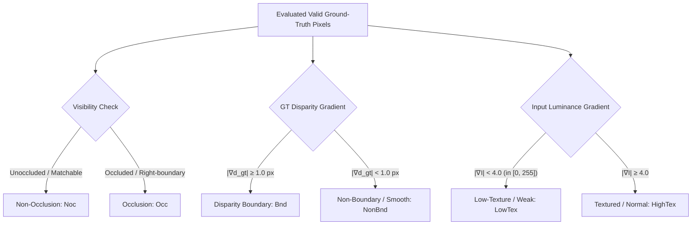

# P5 Quality Plan & Regional Evaluation Protocol

## 1. Executive Summary & Context

Phase 5 (P5) shifts the APG-SGM engine development from core architectural consolidation (P4) to **Product Validation + Algorithm Quality Expansion**.

```text
Baseline Commit: 24aaf30
Contract State: P4 ARCHITECTURE COMPLETE (unqualified)
Compatibility: P4 legacy behavior (QualityMode::Fast, Balanced, HighQuality) strictly frozen
```

### Strategic Triad Priority
1. **Priority 1 (P5C Foundation)**: Python bindings (`pyapg` zero-copy view consumption) and independent C/C++ release distribution validation.
2. **Priority 2 (P5A Quality Mainline)**: Granular regional quality benchmarking, 2-level Hierarchical SGM feasibility, enhanced subpixel interpolation, and occlusion/mismatch refinement.
3. **Priority 3 (P5B Heterogeneous Study)**: Compute backend architecture feasibility only (separation of `ExecutionDevice` / `ComputeBackend` from `VolumeBackend` storage layout); full GPU production backends are deferred.

---

## 2. Regional Quality Benchmark Schema

Traditional global stereo metrics (global EPE, Bad2.0, KITTI D1) mask localized failure modes. A method might improve flat regions while smearing boundaries, producing an artificially lower global EPE.

P5 establishes the **Regional Quality Benchmark Schema**, segmenting evaluated ground-truth pixels into six disjoint or semantic regions:



### Mathematical Definitions

1. **Valid GT Mask**:
   $$\mathcal{M}_{\text{gt}}(x, y) = \mathbb{I}\left(g(x, y) \text{ is finite} \land 0 \le g(x, y) < \text{max\_valid\_gt}\right)$$

2. **Non-Occlusion ($\text{Noc}$) & Occlusion ($\text{Occ}$)**:
   For $(x, y) \in \mathcal{M}_{\text{gt}}$, let $x_r = x - \lfloor g(x, y) \rceil$:
   $$\text{is\_noc}(x, y) = \begin{cases} \text{vis\_mask}(x, y) \ge 200, & \text{if vis\_mask exists} \\ x_r \in [0, W), & \text{otherwise} \end{cases}$$
   $$\text{is\_occ}(x, y) = \neg \text{is\_noc}(x, y)$$

3. **Disparity Boundary ($\text{Bnd}$)**:
   Evaluated purely from ground-truth disparity discontinuities to isolate edge-bleeding and foreshortening artifacts:
   $$\nabla_{\max} g(x, y) = \max_{(nx, ny) \in \mathcal{N}_4(x, y)} |g(x, y) - g(nx, ny)|$$
   $$\text{is\_bnd}(x, y) = \mathbb{I}\left(\nabla_{\max} g(x, y) \ge 1.0\text{ px}\right)$$

4. **Low Texture ($\text{LowTex}$) & High Texture ($\text{HighTex}$)**:
   Evaluated from the left input image luminance gradient $I(x, y) \in [0, 255]$:
   $$\nabla I(x, y) = \sqrt{\left(\frac{\partial I}{\partial x}\right)^2 + \left(\frac{\partial I}{\partial y}\right)^2}$$
   $$\text{is\_lowtex}(x, y) = \mathbb{I}\left(\nabla I(x, y) < 4.0\right), \quad \text{is\_hightex}(x, y) = \mathbb{I}\left(\nabla I(x, y) \ge 4.0\right)$$

---

## 3. P5.0a Canonical Baseline Measurements

Recorded on Middlebury 2014 across all 15 full-resolution benchmark scenes under canonical F-Mode (Prior + Refiner + 4SGM, 16 OpenMP threads, 2 warmup runs, 5 repeat runs, reporting median):

| Scene | Time (ms) | Peak MB | Valid % | All EPE | All Bad2% | All Bad2_all% | Noc Bad2% | Occ Bad2% | Bnd Bad2% | LowTex Bad2% | HighTex Bad2% |
| :--- | :---: | :---: | :---: | :---: | :---: | :---: | :---: | :---: | :---: | :---: | :---: |
| Adirondack   |     99.88 |    88.1 |  99.99% |   1.735 |   11.84% |       11.85% |    7.31% |   61.32% |   42.18% |    12.43% |     10.52% |
| ArtL         |     30.25 |    26.5 |  99.73% |   4.515 |   28.13% |       28.32% |   14.72% |   71.15% |   50.75% |    27.98% |     28.25% |
| Jadeplant    |    122.51 |   143.6 |  98.53% |  10.696 |   32.48% |       33.47% |   17.38% |   84.00% |   58.33% |    34.94% |     29.31% |
| Motorcycle   |     95.86 |    91.3 |  99.80% |   2.130 |   13.69% |       13.86% |    7.05% |   65.58% |   42.74% |    11.80% |     15.26% |
| MotorcycleE  |    109.37 |    89.8 |  99.94% |   2.763 |   15.92% |       15.98% |    9.13% |   68.42% |   47.24% |    12.72% |     18.58% |
| Piano        |     88.67 |    80.2 |  99.97% |   2.097 |   23.13% |       23.16% |   18.43% |   72.87% |   42.13% |    28.32% |     14.77% |
| PianoL       |    106.43 |    99.3 |  99.93% |   6.046 |   37.76% |       37.81% |   34.21% |   75.49% |   52.67% |    44.63% |     26.69% |
| Pipes        |     93.68 |    92.8 |  99.34% |   3.520 |   23.86% |       24.36% |   11.62% |   81.27% |   55.43% |    27.69% |     21.22% |
| Playroom     |    100.76 |    93.8 |  99.39% |   4.093 |   27.18% |       27.63% |   17.89% |   82.37% |   46.08% |    31.25% |     21.85% |
| Playtable    |     93.13 |    89.3 |  99.99% |   4.574 |   27.00% |       27.01% |   20.60% |   76.77% |   44.91% |    22.69% |     30.87% |
| PlaytableP   |     86.82 |    82.7 |  99.98% |   2.088 |   17.38% |       17.39% |   10.47% |   72.00% |   43.22% |    18.57% |     16.32% |
| Recycle      |     98.80 |    91.1 | 100.00% |   1.465 |   13.19% |       13.19% |    9.37% |   59.39% |   34.19% |    12.75% |     14.72% |
| Shelves      |     96.87 |    84.7 | 100.00% |   2.713 |   31.47% |       31.47% |   28.97% |   63.18% |   41.77% |    39.92% |     12.17% |
| Teddy        |     40.82 |    39.0 |  99.93% |   1.517 |   11.73% |       11.79% |    5.35% |   63.89% |   35.63% |     9.77% |     13.96% |
| Vintage      |    120.33 |   135.6 |  99.48% |   2.669 |   23.59% |       23.99% |   20.17% |   62.66% |   31.19% |    30.47% |     11.51% |
| **Overall / Agg** | **1384.18** | **143.6** | **99.73%** | **3.477** | **22.41%** | **22.62%** | **15.76%** | **72.92%** | **46.92%** | **24.77%** | **19.31%** |

### Anti-invalidation Tri-Gate Baseline
| Region | Bad2 (Valid) % | Valid Ratio % | Bad2_all (Unconstrained) % | Total Eval Px |
| :--- | :---: | :---: | :---: | :---: |
| All | 22.41% | 99.73% | 22.62% | 4,586,010 |
| Non-Occluded (Noc) | 15.76% | 100.00% | 15.76% | 4,041,771 |
| Occluded (Occ) | 72.92% | 97.73% | 73.53% | 544,239 |
| Disparity Boundary (Bnd) | 46.92% | 99.91% | 46.97% | 272,041 |
| Low Texture (LowTex) | 24.77% | 99.66% | 25.03% | 2,605,670 |
| High Texture (HighTex) | 19.31% | 99.82% | 19.45% | 1,980,340 |

> [!NOTE]
> **Memory Metric Semantics (`peak_workspace_bytes`)**:
> `peak_workspace_bytes` measures the **high-water retained/allocated capacity of `PipelineBuffers`-owned storage** during the frame. It excludes function-local temporary allocations, allocator/runtime overhead, and process RSS/private commit.

### Key Diagnostic Observations
1. **Occlusion Concentration**: Error rate in occluded regions averages **72.92% Bad2.0 (Valid)** and **73.53% Bad2_all**, compared to **15.76%** in non-occluded regions. Occlusion inpainting (P5.6) directly targets this failure surface without degrading unoccluded pixels.
2. **Boundary Foreshortening**: Disparity boundaries exhibit **46.92% Bad2.0 (Valid)**, more than double the background error rate. Subpixel interpolation (P5.5) and coarse-to-fine expansion (P5.3) must specifically guard boundary error.
3. **Texture Degradation**: Low-texture regions exhibit **24.77% Bad2.0** vs **19.31%** in textured regions.

---

## 4. Phase 5 Implementation Gate Matrix

| Milestone | Target Scope | Decision Gate (GO / NO-GO Criteria) | Fallback / Termination |
| :--- | :--- | :--- | :--- |
| **P5.0** | Regional Quality Schema & Baseline Freeze | Golden contract fingerprints unchanged; Middlebury raw float hashes bit-exact identical; multi-platform CI green. | Pre-requisite to all P5 stages. |
| **P5.1** | Python `pyapg` Bindings | Bit-exact parity with C++; zero internal header leaks; wrapper overhead < 1% pipeline time; stable 100-frame streaming. | Required for external consumption. |
| **P5.2** | Release Artifact Packaging | Clean standalone consumption from C, C++, and Python out of tree. | Required for deployment. |
| **P5.0a** | Evaluation Integrity Polish | Correct denominator-weighted regional aggregation; exact `valid_est_pixels` export; anti-invalidation tri-gate reporting; high-water mark capacity tracking; P5A matched benchmark protocol freeze. | Pre-requisite to P5A algorithm experimentation. |
| **P5.3** | Hierarchical SGM Feasibility | **Performance GO**: Pipeline $\ge 15\%$ faster, EPE regr $\le 1\%$, Bad2 regr $\le 0.5$ pp.<br>OR **Memory GO**: Peak workspace memory $\ge 30\%$ lower, latency regr $\le 5\%$, quality within limits.<br>Tri-gate: Valid% regr $\le 0.5$ pp, Bad2_all non-regressing. | Close branch if neither gate passes; do not productionize. |
| **P5.5** | Subpixel Quality Study | Global EPE improves $\ge 2\%$ OR subpixel-region EPE improves $\ge 5\%$; Bad2 no meaningful regression; overhead $\le 3\%$. | Revert to standard parabolic fitting if gates fail. |
| **P5.6** | Occlusion / Mismatch Refinement | Occlusion-region Bad2 improves $\ge 5\%$ relative; global EPE regr $\le 1\%$, boundary Bad2 regr $\le 1.0$ pp, overhead $\le 5\%$. Tri-gate: Occ Valid% regr $\le 0.5$ pp, Occ Bad2_all non-regressing. | Close branch if edge-bleeding or boundary regression occurs. |
| **P5.7** | `QualityV2` Integration | Combined mean EPE improvement $\ge 5\%$ OR mean Bad2 relative improvement $\ge 8\%$; $\ge 12/15$ scenes non-regressing; latency $\le 1.15\times$ baseline. | Must include full attribution ablation (`hierarchical_only`, `subpixel_only`, `occlusion_only`). |
| **P5.8** | Release Closure | P4 legacy profiles retain frozen bit-exact hashes; `QualityV2` hashes documented; release artifacts verified. | P5 formal close. |

---

## 5. Frozen Hash Invariance Proof

All 15 Middlebury scenes evaluated under P5.0a match the canonical P4 golden 64-bit FNV-1a hashes byte-for-byte:

- `Adirondack`: `0x4bf310d083d2a3e8` (Match: TRUE)
- `ArtL`: `0xb16c3b15c58b742b` (Match: TRUE)
- `Jadeplant`: `0x3fb3bca67979ab10` (Match: TRUE)
- `Motorcycle`: `0xb35a74694ab56e47` (Match: TRUE)
- `MotorcycleE`: `0x71c841d3c22f5a3d` (Match: TRUE)
- `Piano`: `0x3200f5f4c8942b98` (Match: TRUE)
- `PianoL`: `0xdf6cf3e1d6d3aa49` (Match: TRUE)
- `Pipes`: `0x1983b2be001f6ece` (Match: TRUE)
- `Playroom`: `0xdbffb47fb1e7b7c9` (Match: TRUE)
- `Playtable`: `0xc24126c5073151d3` (Match: TRUE)
- `PlaytableP`: `0xe593212b18ec9bd7` (Match: TRUE)
- `Recycle`: `0xb1fdfc20744ecffb` (Match: TRUE)
- `Shelves`: `0x9f140b58e044bb3e` (Match: TRUE)
- `Teddy`: `0x4ad951f3f3a063ad` (Match: TRUE)
- `Vintage`: `0xdc638a635cf8eb90` (Match: TRUE)

---

## 6. P5A Matched / Interleaved Benchmark Protocol

To ensure all algorithm decisions in P5A (P5.3 through P5.7) rest on reproducible, drift-free evidence:

1. **Quality Reference vs. Runtime Benchmark Separation**:
   - `P5.0a baseline CSV` (`results/p5_baseline/middlebury_f_mode_baseline.csv`) serves as the **frozen quality and diagnostic reference** (error rates, valid ratios, hashes, peak capacities).
   - Runtime speedup / latency comparisons **must never use cross-session historical CSVs**. Every runtime GO/NO-GO gate requires a freshly measured, matched baseline execution.
2. **Matched Execution Environment**:
   - Baseline worktree/binary vs. Candidate worktree/binary must be measured on:
     - Identical physical machine and OS power profile;
     - Identical compiler, optimization flags, and CMake Release build type;
     - Identical thread count (`--threads 16`), warmup count (`--warmup 2`), and repeat count (`--repeat 5`);
     - Identical dataset manifest and resolution.
3. **Interleaved Execution Order**:
   - To cancel out thermal throttling, CPU frequency scaling, and background OS scheduling jitter, benchmark runs must execute in interleaved order (e.g., $B \to C \to C \to B$ or $C \to B \to B \to C$, where $B$ is baseline and $C$ is candidate).
4. **Lane Clarification**:
   - The command `--modes F --backend packed` is designated as the **P5.3 Feasibility Performance Lane** (evaluating packed search-space optimization). It is not the historical P4 canonical gate (which did not force packed backend).
5. **Anti-invalidation Tri-Gate Decision Rule**:
   - No algorithm improvement may claim victory by discarding uncertain pixels. Every candidate must satisfy the tri-gate:
     1. $\text{Bad2}_{\text{valid}}$ relative improvement $\ge$ target threshold;
     2. $\text{Valid\%}$ regression $\le 0.5$ percentage points;
     3. $\text{Bad2}_{\text{all}}$ (unconstrained error with invalid pixels counted as errors) non-regressing ($\le 0$ pp degradation).
